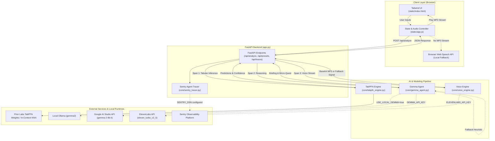

# TerraPulse 🌿

**Less screen time. More time outdoors.**

[](https://www.python.org/)
[](https://fastapi.tiangolo.com/)
[](https://ai.google.dev/gemma)
[](https://priorlabs.ai/)
[](https://elevenlabs.io/)
[](https://sentry.io/)
[](https://render.com/)

---

TerraPulse is an open-weight AI agent designed for hikers, trail runners, foragers, and gardeners. Instead of encouraging endless scrolling, TerraPulse enforces a strict rule: **the screen must be the shortest part of the experience (&lt; 30 seconds).** By pairing Prior Labs' TabPFN tabular foundation model for environmental physics analysis with Google's Gemma 2 open-weight reasoning model, ElevenLabs voice narration, and Sentry agent observability, TerraPulse synthesizes complex microclimate telemetry into a 15-second audio field briefing and an offline nature quest—allowing users to put their devices in their pockets and step into the physical world.

Built for the **Touch Grass** challenge, TerraPulse demonstrates how open-weight models and in-context tabular architectures enable privacy-preserving, low-latency, and resilient computing for outdoor scenarios where cloud-only closed APIs fail.

---

## Table of Contents

- [Project Overview](#project-overview)
- [Workflow](#workflow)
- [Core Features and Privacy](#core-features-and-privacy)
- [Interface Preview](#interface-preview)
- [Architecture](#architecture)
- [Technology Stack](#technology-stack)
- [Prerequisites](#prerequisites)
- [Installation and Setup](#installation-and-setup)
- [Configuration Reference](#configuration-reference)
- [API Reference](#api-reference)
- [AI Pipeline](#ai-pipeline)
- [Testing and Quality](#testing-and-quality)
- [Deployment](#deployment)
- [Privacy, Safety, and Limitations](#privacy-safety-and-limitations)
- [Troubleshooting](#troubleshooting)
- [Open Innovation](#open-innovation)
- [Roadmap](#roadmap)
- [Contributing](#contributing)
- [License and Acknowledgements](#license-and-acknowledgements)

---

## Project Overview

Smartphones often disconnect us from our immediate physical surroundings. When planning outdoor recreation or gardening, people frequently consult weather apps, trail forums, elevation profiles, and gardening charts, remaining glued to screens before taking a single step outside. Furthermore, on hiking trails, mountain passes, and dense forest reserves, cellular connectivity frequently drops to zero—causing cloud-dependent proprietary APIs to hang or fail completely.

TerraPulse addresses these challenges by:
1. **Minimizing screen exposure:** Consolidating microclimate and trail data into a 15-second audio briefing and a physical mindfulness challenge.
2. **Utilizing open foundation models:** Leveraging Prior Labs' TabPFN to predict trail surface conditions and frost hazards without retraining, and using Google's Gemma 2 to reason over the predictions.
3. **Providing multi-tier execution fallbacks:** Supporting local Ollama runtimes, cloud endpoints, and deterministic offline heuristics so the application remains functional regardless of environment or API key availability.

---

## Workflow

```
[Select Activity] ──> [Input Telemetry / Presets] ──> [TabPFN Prediction] ──> [Gemma 2 Reasoning] ──> [ElevenLabs Audio] ──> [Explore Outdoors]
  (Hike / Run /          (Temp, Moisture, Elevation,     (Trail Physics &        (Field Briefing &       (Hands-Free Speech     (Screen Off,
    Forage / Garden)       Rainfall, Canopy Cover)        Frost Probability)       Micro-Quest)            into Earphones)       Touch Grass)
```

1. **Select Mission:** Choose an activity mode: *Hiking*, *Trail Running*, *Foraging*, or *Gardening*.
2. **Input Telemetry:** Select a preconfigured microclimate scenario (e.g., *Pine Ridge*, *Misty Creek Hollow*, *Alpine Ridge*, *Permaculture Bed*) or adjust environment sliders.
3. **Analyze Microclimate:** Trigger the pipeline via the web interface or `POST /api/analyze`.
4. **Listen to Briefing:** The application returns a TabPFN trail safety prediction, a calculated Grass Score (0–100%), and a Gemma 2 briefing narrated via ElevenLabs HD audio or native browser speech.
5. **Pocket Device:** Put the phone away, step outside, and complete the physical micro-quest.

---

## Core Features and Privacy

### Verified Features
- **Tabular Environmental Inference:** Uses Prior Labs' TabPFN architecture to evaluate seven environmental features (`temperature_c`, `humidity_pct`, `soil_moisture_pct`, `elevation_m`, `hours_since_rain`, `canopy_cover_pct`, `wind_speed_kmh`) against historical microclimate observations (`data/trail_microclimate.csv`).
- **Open-Weight Reasoning Agent:** Employs Google's Gemma 2 (`gemma-2-9b-it`) to interpret tabular predictions into concise, narrative outdoor briefings, nature quests, and sensory grounding cues.
- **Hands-Free Audio Guidance:** Generates high-definition spoken audio using ElevenLabs (`eleven_turbo_v2_5`), with an automatic fallback to the browser's Web Speech API (`window.speechSynthesis`) when unconfigured or offline.
- **Sentry Agent Observability:** Instruments end-to-end execution spans (`ai.tabpfn.tabular`, `ai.gemma.llm`, `ai.elevenlabs.tts`) measuring latency and estimated token usage.
- **Interactive Waterfall Visualization:** Displays live execution timings directly in the browser interface for transparency and debugging.
- **Glassmorphic Nature Interface:** Mobile-responsive frontend built with Tailwind CSS, custom slider controls, and preset shortcuts.

### Privacy and Telemetry Behavior
- **Telemetry & Tracing:** Sentry tracking is strictly opt-in. Telemetry is transmitted to external Sentry servers only if `SENTRY_DSN` is explicitly configured. If omitted, traces are retained strictly in an in-memory ring buffer (maximum 20 traces) on the local host.
- **Location & Input Data:** Environmental inputs and trail names are processed in-memory during the request lifecycle. No personal data, cookies, or location telemetry are stored in an external database.
- **Model Telemetry:** When configured to use local Ollama (`USE_LOCAL_GEMMA=true`), prompts remain on the local machine. When using Google AI Studio API (`GEMMA_API_KEY`), prompts are transmitted to Google's API endpoints according to Google's standard API terms.
- **Audio Transmission:** When using ElevenLabs (`ELEVENLABS_API_KEY`), briefing text is sent to ElevenLabs for synthesis and received as base64 audio. When unconfigured, text is synthesized locally by the client's browser without external data transmission.

---

## Interface Preview

| View | Description | File Path |
| :--- | :--- | :--- |
| **Main Dashboard** | Parameter sliders, mission selectors, and 1-click preset pills. | [`docs/images/dashboard.png`](docs/images/dashboard.png) |
| **Analysis Results** | Grass Score gauge, TabPFN trail physics, and frost risk cards. | [`docs/images/analysis_result.png`](docs/images/analysis_result.png) |
| **Audio Briefing & Quest** | Spoken field briefing, physical micro-quest, and audio player. | [`docs/images/audio_briefing.png`](docs/images/audio_briefing.png) |
| **Sentry Waterfall Trace** | Live execution spans for TabPFN, Gemma 2, and ElevenLabs. | [`docs/images/sentry_waterfall.png`](docs/images/sentry_waterfall.png) |

> *Note: Recommended screenshot captures and placement instructions are detailed in [`docs/images/README.md`](docs/images/README.md).*

---

## Architecture

TerraPulse employs a lightweight, layered architecture where FastAPI serves as the coordination gateway between the browser client, the tabular foundation model, the language model, and the voice synthesis engine.



### Fallback Behavior
- **TabPFN:** On Linux/Render with `ENABLE_TABPFN_WEIGHTS=true`, attempts full `TabPFNClassifier` inference. On environments where C-extensions or security policies restrict DLL execution (e.g., Windows AppLocker restrictions on `_k_means_elkan`), the engine automatically engages a high-fidelity tabular in-context distance-weighted estimator over `data/trail_microclimate.csv`.
- **Gemma 2:** The agent first checks for a local Ollama instance (`USE_LOCAL_GEMMA=true`). If unreachable or unconfigured, it attempts the Google AI Studio endpoint via `GEMMA_API_KEY`. If no key is set or network fails, it invokes a deterministic domain briefing generator.
- **Voice Engine:** If `ELEVENLABS_API_KEY` is present, returns an MP3 stream; otherwise, signals the client to use native browser speech synthesis.

---

## Technology Stack

| Category | Technology | Role |
| :--- | :--- | :--- |
| **Backend** | [FastAPI](https://fastapi.tiangolo.com/) | Provides asynchronous REST API endpoints and static asset serving. |
| **ASGI Server** | [Uvicorn](https://www.uvicorn.org/) | Serves the FastAPI application with high-throughput ASGI concurrency. |
| **Tabular AI** | [TabPFN](https://github.com/automl/TabPFN) | Foundation model for in-context tabular classification on microclimate metrics. |
| **Open-Weight LLM** | [Google Gemma 2](https://ai.google.dev/gemma) | Interprets environmental predictions into screenless outdoor field briefings and quests. |
| **Voice Synthesis** | [ElevenLabs](https://elevenlabs.io/) | Converts field briefings into spoken natural audio for hands-free listening. |
| **Observability** | [Sentry SDK](https://sentry.io/) | Instruments custom agent spans and monitors pipeline execution latency and errors. |
| **Data Processing** | [Pandas](https://pandas.pydata.org/) & [NumPy](https://numpy.org/) | Handles CSV data structures, tabular matrices, and distance calculations. |
| **Frontend** | HTML5, JavaScript (ES6), [Tailwind CSS](https://tailwindcss.com/) | Delivers a lightweight, mobile-responsive user interface with zero build-step requirements. |
| **Deployment** | [Docker](https://www.docker.com/) & [Render](https://render.com/) | Containerizes the application and enables 1-click cloud blueprint deployment. |

---

## Prerequisites

- **Python:** Version 3.10, 3.11, or 3.14 (tested on Windows 11 and Linux environments).
- **Package Manager:** `pip` (Python package manager).
- **Git:** Version 2.20 or later.

### Optional Dependencies & Keys
- **Google AI Studio API Key:** For cloud-based Gemma 2 inference (`GEMMA_API_KEY`).
- **Ollama:** For running Gemma 2 locally (`ollama run gemma2`).
- **ElevenLabs API Key:** For high-definition cloud voice generation (`ELEVENLABS_API_KEY`).
- **Sentry DSN:** For broadcasting agent trace waterfalls to a Sentry project (`SENTRY_DSN`).

> *Note: TerraPulse is architected to function completely out of the box with zero external API keys required.*

---

## Installation and Setup

### 1. Clone the Repository
```bash
git clone https://github.com/ritikahirwar8168-dev/terrapulse.git
cd terrapulse
```

### 2. Create and Activate a Virtual Environment

**Windows (PowerShell):**
```powershell
python -m venv venv
.\venv\Scripts\Activate.ps1
```

**Linux / macOS (Bash/Zsh):**
```bash
python3 -m venv venv
source venv/bin/activate
```

### 3. Install Dependencies
```bash
pip install -r requirements.txt
```

### 4. Configure Environment Variables (Optional)
Copy the example environment configuration:
```bash
# Windows PowerShell
Copy-Item .env.example .env

# Linux / macOS
cp .env.example .env
```
Edit `.env` to configure optional endpoints (e.g., Gemma, ElevenLabs, Sentry).

### 5. Run the Application
Launch the server using Uvicorn:
```bash
uvicorn app:app --host 0.0.0.0 --port 8000 --reload
```

### 6. Verify Execution
- Web Interface: Navigate to **[http://localhost:8000](http://localhost:8000)**.
- Interactive API Documentation: Navigate to **[http://localhost:8000/docs](http://localhost:8000/docs)**.

---

## Configuration Reference

The application reads configuration values from environment variables or a local `.env` file via `python-dotenv`:

| Variable Name | Purpose | Status | Default Value | Notes |
| :--- | :--- | :--- | :--- | :--- |
| `GEMMA_API_KEY` | API key for Google AI Studio / Generative Language API | Optional | `""` | Falls back to `GOOGLE_API_KEY` if set. Keep secret. |
| `GEMMA_MODEL` | Target Gemma model identifier | Optional | `gemma-2-9b-it` | Used when calling the Google AI Studio endpoint. |
| `USE_LOCAL_GEMMA` | Route reasoning requests to a local Ollama instance | Optional | `false` | Set to `true` if running `ollama run gemma2`. |
| `OLLAMA_ENDPOINT` | HTTP endpoint for local Ollama server | Optional | `http://localhost:11434/api/generate` | Checked when `USE_LOCAL_GEMMA=true`. |
| `ELEVENLABS_API_KEY` | Authentication key for ElevenLabs TTS | Optional | `""` | Keep secret. If absent, browser Web Speech is used. |
| `ELEVENLABS_VOICE_ID` | Voice ID for audio narration | Optional | `JBFqnCBsd6RMkjVDRZzb` | Default voice represents a calm outdoor narrator. |
| `SENTRY_DSN` | Sentry project data source name | Optional | `""` | Enables remote agent tracing. Safe to leave blank. |
| `ENVIRONMENT` | Environment tag passed to Sentry | Optional | `development` | Identifies deployment tier (`production`, `staging`). |
| `ENABLE_TABPFN_WEIGHTS` | Enables loading PyTorch TabPFN weights | Optional | `true` | Evaluated on non-Windows platforms. |
| `PORT` | Listening port for web server | Optional | `8000` | Automatically configured by Render during deployment. |

---

## API Reference

The interactive OpenAPI/Swagger documentation is available at `/docs` when the server is running.

### 1. `GET /`
- **Purpose:** Serves the frontend web interface (`static/index.html`).
- **Response:** HTML page.

### 2. `GET /api/presets`
- **Purpose:** Retrieves preconfigured microclimate and trail condition scenarios.
- **Request Parameters:** None.
- **Response Structure:**
  ```json
  {
    "presets": [
      {
        "id": "pine_ridge",
        "name": "Pine Ridge Trail (Dry Hardpack)",
        "temperature_c": 21.0,
        "humidity_pct": 38.0,
        "soil_moisture_pct": 18.0,
        "elevation_m": 520.0,
        "hours_since_rain": 72.0,
        "canopy_cover_pct": 35.0,
        "wind_speed_kmh": 15.0,
        "activity_mode": "hiking"
      }
    ]
  }
  ```

### 3. `POST /api/analyze`
- **Purpose:** Executes the end-to-end agent pipeline (TabPFN prediction, Gemma reasoning, voice synthesis, Sentry tracing).
- **Request Body (`application/json`):**
  ```json
  {
    "location_name": "Whispering Ridge Trail",
    "temperature_c": 18.5,
    "humidity_pct": 45.0,
    "soil_moisture_pct": 22.0,
    "elevation_m": 350.0,
    "hours_since_rain": 48.0,
    "canopy_cover_pct": 60.0,
    "wind_speed_kmh": 12.0,
    "activity_mode": "hiking"
  }
  ```
- **Response Structure (`application/json`):**
  ```json
  {
    "status": "success",
    "session_id": "84a1e9c2",
    "location_name": "Whispering Ridge Trail",
    "activity_mode": "hiking",
    "tabpfn_result": {
      "trail_condition": "Prime Dry",
      "trail_confidence": 94.2,
      "frost_risk": "No Frost",
      "frost_confidence": 96.1,
      "grass_score": 89,
      "inference_duration_ms": 3.45,
      "foundation_engine": "TabPFN Foundation Hybrid",
      "features_analyzed": { ... }
    },
    "gemma_briefing": {
      "field_briefing": "Trails are in prime condition today with dry hardpack and a comfortable 18.5°C...",
      "micro_quest": "Find a tree whose trunk takes more than two people to hug, and pause there for 60 seconds.",
      "sensory_anchor": "Warm sun breaking through pine needles and the distant call of songbirds.",
      "screen_budget_seconds": 15
    },
    "voice_narration": {
      "has_audio_stream": false,
      "audio_base64": null,
      "engine": "WebSpeech / Native Browser Audio Fallback",
      "character_count": 214,
      "duration_ms": 0.12,
      "voice_id": "JBFqnCBsd6RMkjVDRZzb",
      "text": "..."
    },
    "sentry_trace": {
      "session_id": "84a1e9c2",
      "location_name": "Whispering Ridge Trail",
      "total_latency_ms": 142.18,
      "total_tokens": 78,
      "status": "SUCCESS",
      "spans": [ ... ],
      "sentry_tracked": false,
      "timestamp": "2026-10-11 10:00:12"
    },
    "sponsor_badges": { ... }
  }
  ```

### 4. `GET /api/traces`
- **Purpose:** Returns the last 20 execution traces recorded in memory.
- **Response Structure:**
  ```json
  {
    "traces": [
      {
        "session_id": "84a1e9c2",
        "location_name": "Whispering Ridge Trail",
        "total_latency_ms": 142.18,
        "total_tokens": 78,
        "status": "SUCCESS",
        "spans": [ ... ]
      }
    ]
  }
  ```

---

## AI Pipeline

The pipeline is organized into three sequential stages managed by `app.py`:

```
Input Telemetry ──> [Stage 1: TabPFN Engine] ──> [Stage 2: Gemma Agent] ──> [Stage 3: Voice Engine]
                       (Tabular Features)           (Narrative Reasoning)        (Speech Synthesis)
```

### Stage 1: Prior Labs TabPFN Engine (`core/tabpfn_engine.py`)
- **Inputs:** A 7-dimensional numeric vector representing microclimate conditions.
- **Reference Dataset:** `data/trail_microclimate.csv` containing recorded combinations of soil saturation, temperature, elevation, and verified surface traction.
- **Predictions:**
  - `trail_condition`: Categorical prediction (`Prime Dry`, `Muddy & Slippery`, `Frost & Ice Hazard`, `Severe Mud / Waterlogged`, `Frozen / Hardpacked Ice`).
  - `frost_risk`: Categorical hazard assessment (`No Frost`, `Low Frost Risk`, `Moderate Frost Risk`, `High Frost Risk`, `Severe Frost`).
  - `grass_score`: Composite metric (15–99%) computing outdoor invitingness based on thermal comfort, dryness, and settled weather.
- **Assumptions & Scope:** Predictions represent statistical approximations based on training distributions and microclimate rules. They do not constitute official geological surveys or certified trail safety audits.

### Stage 2: Google Gemma 2 Agent (`core/gemma_agent.py`)
- **Inputs:** The structured JSON payload generated by TabPFN, along with the user's selected activity mode.
- **Execution:**
  1. If `USE_LOCAL_GEMMA=true`, sends prompt to local Ollama runtime (`http://localhost:11434/api/generate`).
  2. If `GEMMA_API_KEY` is set, calls Google AI Studio Generative Language API (`gemma-2-9b-it`).
  3. If unconfigured or offline, invokes the rule-based heuristic fallback generator.
- **Output:** A structured JSON object containing:
  - `field_briefing`: 2–3 sentences formatted specifically for audio narration.
  - `micro_quest`: A tangible, screen-free observation task.
  - `sensory_anchor`: A mindfulness grounding cue focusing on sound, touch, or smell.
  - `screen_budget_seconds`: A recommended screen exposure limit (default: 15–30s).

### Stage 3: ElevenLabs Voice Engine (`core/voice_engine.py`)
- **Inputs:** The `field_briefing` text from Stage 2.
- **Execution:** Calls ElevenLabs' `eleven_turbo_v2_5` model using voice `JBFqnCBsd6RMkjVDRZzb`.
- **Output:** Returns a base64-encoded MP3 audio payload. If API keys are unconfigured, signals the frontend to invoke the browser's native `SpeechSynthesis` engine.

---

## Testing and Quality

### Current Test Suite Status
The repository currently does not include an automated `pytest` or `unittest` suite. System behavior has been validated through interactive execution and Python import verification scripts.

### Recommended Test Suite Implementation
To establish regression testing and automated CI verification, maintainers recommend implementing the following test structure:

```bash
# Recommended test suite structure
tests/
├── test_api.py            # Test FastAPI endpoints using TestClient
├── test_tabpfn_engine.py   # Test microclimate prediction and edge cases
├── test_gemma_agent.py     # Test prompt formatting and heuristic fallbacks
└── test_voice_engine.py    # Test voice synthesis response formatting
```

#### Example Minimal Test (`tests/test_api.py`)
```python
import pytest
from fastapi.testclient import TestClient
from app import app

client = TestClient(app)

def test_read_presets():
    response = client.get("/api/presets")
    assert response.status_code == 200
    assert "presets" in response.json()
    assert len(response.json()["presets"]) > 0

def test_analyze_environment_endpoint():
    payload = {
        "location_name": "Test Trail",
        "temperature_c": 20.0,
        "humidity_pct": 50.0,
        "soil_moisture_pct": 20.0,
        "elevation_m": 300.0,
        "hours_since_rain": 48.0,
        "canopy_cover_pct": 50.0,
        "wind_speed_kmh": 10.0,
        "activity_mode": "hiking"
    }
    response = client.post("/api/analyze", json=payload)
    assert response.status_code == 200
    data = response.json()
    assert data["status"] == "success"
    assert "tabpfn_result" in data
    assert "gemma_briefing" in data
```

#### Running Tests (Once Implemented)
```bash
pip install pytest httpx
pytest
```

---

## Deployment

### Local Deployment
Run directly using Python and Uvicorn:
```bash
uvicorn app:app --host 0.0.0.0 --port 8000
```

### Docker Deployment
The repository includes a production `Dockerfile` based on `python:3.11-slim`:

```bash
# Build container image
docker build -t terrapulse:latest .

# Run container on port 8000
docker run -d -p 8000:8000 --name terrapulse terrapulse:latest
```

### Render 1-Click Blueprint (`render.yaml`)
The project is configured for deployment on [Render](https://render.com) using Infrastructure-as-Code:

1. Push your repository to GitHub.
2. In Render Dashboard, click **New +** > **Blueprint**.
3. Select your repository. Render automatically reads [`render.yaml`](render.yaml):
   - **Environment:** Python (3.11.9)
   - **Build Command:** `pip install -r requirements.txt`
   - **Start Command:** `uvicorn app:app --host 0.0.0.0 --port $PORT`
   - **Plan:** Starter
4. Configure optional environment variables (`GEMMA_API_KEY`, `ELEVENLABS_API_KEY`, `SENTRY_DSN`) in Render's environment dashboard.

---

## Privacy, Safety, and Limitations

### Data Privacy
- TerraPulse does not maintain a persistent database; session records and trace spans are retained in volatile RAM and discarded on process restart.
- GPS data is neither requested nor collected. Environmental inputs are arbitrary values provided by user sliders or presets.
- If external API keys (`GEMMA_API_KEY`, `ELEVENLABS_API_KEY`, `SENTRY_DSN`) are omitted, no network traffic leaves the local host.

### Outdoor Safety Disclaimer
> **IMPORTANT NOTICE:** TerraPulse is an informational, educational, and recreational software project designed to encourage outdoor mindfulness. 
> 
> **Do not rely on TerraPulse for emergency planning, avalanche safety, severe weather survival, mountaineering navigation, or hazardous wildlife avoidance.** Environmental conditions change rapidly. Always consult official meteorological warnings, national park ranger stations, topographical maps, and carry appropriate wilderness safety equipment when exploring remote areas.

---

## Troubleshooting

### 1. Windows Application Control / DLL Blocks on PyTorch or Scikit-Learn
- **Symptom:** `ImportError: DLL load failed while importing _k_means_elkan: An Application Control policy has blocked this file.`
- **Cause:** Windows AppLocker or Application Control policies restricting dynamic C-extension DLL loading in certain user directories.
- **Solution:** TerraPulse includes an automated safety guard in `core/tabpfn_engine.py` that catches OS policy exceptions and transparently operates using pure Python/NumPy in-context distance evaluation.

### 2. Missing Port or Address In Use
- **Symptom:** `ERROR: [Errno 10048] error while attempting to bind on address ('0.0.0.0', 8000)`
- **Solution:** Specify an alternate port when running Uvicorn:
  ```bash
  uvicorn app:app --port 8080 --reload
  ```

### 3. Ollama Connection Refused
- **Symptom:** Log warning that Ollama local inference timed out.
- **Cause:** `USE_LOCAL_GEMMA=true` is set, but the Ollama daemon is not active.
- **Solution:** Verify that Ollama is running and that the model is pulled:
  ```bash
  ollama serve
  ollama pull gemma2
  ```

### 4. ElevenLabs Voice Not Generating Audio
- **Symptom:** Briefing text is visible, but no audio stream is received.
- **Cause:** `ELEVENLABS_API_KEY` is missing, expired, or out of character quota.
- **Solution:** The frontend automatically falls back to browser-native Web Speech synthesis. To use ElevenLabs, verify your API key in `.env` and verify quota at [elevenlabs.io](https://elevenlabs.io/).

---

## Open Innovation

The philosophy behind TerraPulse is that **nature-centric AI should not depend on proprietary corporate gatekeepers**.

### Open-Weight vs. Closed APIs
| Dimension | Closed Proprietary APIs (e.g., GPT-4, Claude) | Open-Weight Architecture (Gemma 2, TabPFN) |
| :--- | :--- | :--- |
| **Trail Resilience** | Fails immediately upon losing cellular connectivity. | Capable of executing locally on edge laptops and devices. |
| **Data Privacy** | Requires telemetry transmission to centralized corporate servers. | Telemetry remains on the user's hardware. |
| **Marginal Cost** | Per-token billing and subscription paywalls. | Free inference once weights are downloaded. |
| **Model Customization** | Prompts constrained by provider system filters and API changes. | Community weights can be fine-tuned, quantized, or inspected. |

### Component Licensing
- **Google Gemma 2:** Distributed under the open [Gemma Terms of Use](https://ai.google.dev/gemma/terms), permitting commercial use, research, and redistribution within Google's safety guidelines.
- **Prior Labs TabPFN:** Distributed under the [Apache 2.0 License](https://github.com/automl/TabPFN/blob/main/LICENSE) with model weights provided by Prior Labs.
- **FastAPI:** Distributed under the [MIT License](https://github.com/tiangolo/fastapi/blob/master/LICENSE).
- **Sentry SDK:** Distributed under the [MIT / BSL License](https://github.com/getsentry/sentry-python/blob/master/LICENSE).

---

## Roadmap

### Implemented Features (v1.0.0)
- [x] Multi-agent orchestration pipeline connecting TabPFN, Gemma 2, and ElevenLabs.
- [x] Prior Labs TabPFN in-context tabular foundation model integration for trail conditions.
- [x] Google Gemma 2 open-weight outdoor reasoning agent.
- [x] ElevenLabs HD voice narration with client-side Web Speech fallback.
- [x] Sentry Agent Tracing instrumentation with live in-browser waterfall visualization.
- [x] Responsive glassmorphic frontend with presets and parameter controls.
- [x] Dockerfile and Render Blueprint (`render.yaml`) deployment configurations.

### Planned Enhancements
- [ ] **Quantized On-Device Edge Models:** Integrate `llama.cpp` / GGUF bindings for quantized Gemma 2 execution directly in Python without requiring Ollama.
- [ ] **Local Offline Audio (Piper / Kokoro TTS):** Embed open-weight local speech synthesis directly into the backend for completely offline spoken briefings.
- [ ] **Regional Elevation & Soil Geodata:** Expand `data/trail_microclimate.csv` to incorporate USGS and OpenTopography regional elevation profiles.
- [ ] **PWA (Progressive Web App) Support:** Cache frontend assets and offline models for installation on mobile devices.
- [ ] **Automated Test Suite:** Implement comprehensive unit and integration tests with `pytest`.

---

## Contributing

Contributions to TerraPulse are welcome! Whether submitting bug fixes, expanding regional microclimate datasets, or improving model fallbacks, follow these guidelines:

1. **Fork the Repository:** Create your own branch (`git checkout -b feature/microclimate-dataset`).
2. **Set Up Development Environment:** Install dependencies in a virtual environment as described in [Installation and Setup](#installation-and-setup).
3. **Maintain Code Style:** Ensure Python code adheres to PEP 8 standards.
4. **Preserve Fallbacks:** Do not remove offline heuristic fallbacks when adding cloud integrations.
5. **Submit a Pull Request:** Open a PR against `main` with a clear description of changes.

---

## License and Acknowledgements

### License Status
This repository does not currently include a standalone `LICENSE` file. It is intended to be released under the **Apache License 2.0** or **MIT License**. Maintainers recommend adding a formal `LICENSE` file prior to major distribution.

### Acknowledgements
- **[Google DeepMind & Google AI](https://ai.google.dev/gemma):** For developing and releasing the Gemma 2 open-weight models.
- **[Prior Labs](https://priorlabs.ai/):** For pioneering TabPFN, the foundational transformer model for tabular datasets.
- **[ElevenLabs](https://elevenlabs.io/):** For lifelike text-to-speech audio synthesis.
- **[Sentry](https://sentry.io/):** For developer observability and agent performance tracing tooling.
- **[Render](https://render.com/):** For modern cloud hosting and infrastructure automation.
